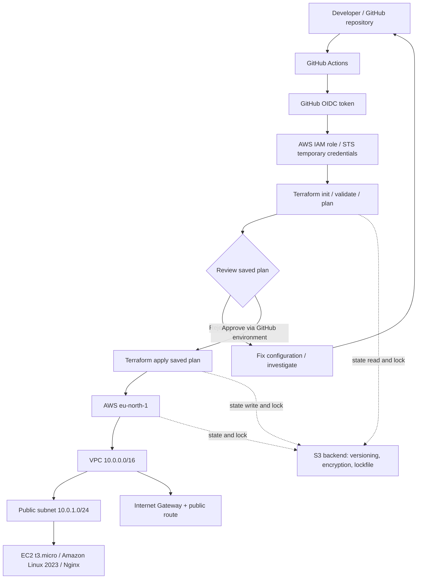
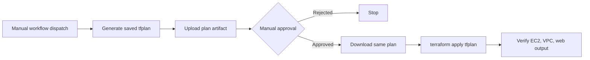

# AWS Infrastructure Automation with Terraform & GitHub Actions

   

## Overview

A hands-on Infrastructure as Code (IaC) project that provisions, validates, monitors for drift, repairs, and safely tears down a small AWS environment using **Terraform** and **GitHub Actions**. The deployment pipeline authenticates to AWS through **GitHub OIDC**, stores Terraform state in **Amazon S3**, and requires a **manual approval gate** before applying infrastructure changes.

**Tested end to end:** provisioning seven AWS resources, introducing an out-of-band EC2 tag change, detecting drift, remediating it through controlled Apply, and destroying the infrastructure.

> **Scope:** A personal learning/portfolio lab, not a production-ready reference architecture. An Application Load Balancer (ALB) is a future enhancement and is **not** included in the tested deployment.

## Architecture



### AWS resources created by the initial deployment

| Resource | Purpose |
|---|---|
| VPC | Isolated network (`10.0.0.0/16`) |
| Public subnet | EC2 placement (`10.0.1.0/24`, `eu-north-1a`) |
| Internet gateway | Internet connectivity |
| Route table | Default route to internet gateway |
| Route table association | Associates subnet with public route table |
| Security group | Allows inbound HTTP (TCP/80) for the lab |
| EC2 instance | `t3.micro`, 8 GiB encrypted gp3, Amazon Linux 2023, Nginx |

The S3 backend bucket was **bootstrapped separately** in the AWS Console, so it is not among the seven resources in the Terraform deployment.

## Technology stack

- **Cloud:** AWS (`eu-north-1`, Stockholm)
- **IaC:** Terraform with reusable `vpc` and `ec2` modules
- **Automation:** GitHub Actions
- **Identity:** GitHub OIDC → AWS IAM role → AWS STS temporary credentials
- **State:** Amazon S3, server-side encryption, bucket versioning, `use_lockfile = true`
- **Compute:** Amazon EC2 (`t3.micro`) with Nginx installed using user data
- **Networking:** VPC, subnet, internet gateway, route table, security group

## Repository structure

```text
.
├── .github/
│   └── workflows/
│       ├── test-aws-oidc.yml
│       ├── terraform-backend-test.yml
│       ├── terraform-apply.yml
│       ├── terraform-drift.yml
│       └── terraform-destroy.yml
├── environments/
│   └── dev/
│       ├── backend.tf
│       ├── main.tf
│       └── outputs.tf
├── modules/
│   ├── vpc/
│   │   ├── main.tf
│   │   └── outputs.tf
│   └── ec2/
│       ├── main.tf
│       └── outputs.tf
└── README.md
```

> The structure above reflects the implementation described in this project. If workflow filenames differ in your repository, update this section to match.

## End-to-end workflow

### 1. Authenticate GitHub Actions to AWS

1. Create the AWS IAM OIDC provider for `https://token.actions.githubusercontent.com` with audience `sts.amazonaws.com`.
2. Create the IAM role `GitHubActions-Terraform-Lab-Role`.
3. Restrict its trust policy to the actual GitHub repository and `main` branch OIDC subject.
4. Set the GitHub Actions repository variable `AWS_ROLE_ARN` to the IAM role ARN.
5. Run **Test AWS OIDC Authentication** and confirm `aws sts get-caller-identity` returns the assumed role.

No long-lived AWS access keys are stored in GitHub.

### 2. Bootstrap remote Terraform state

1. Create a private S3 bucket in `eu-north-1`.
2. Enable versioning, server-side encryption, and Block Public Access.
3. Grant the IAM role permissions to read/write the state object and manage its `.tflock` lock object.
4. Configure `environments/dev/backend.tf`:

```hcl
terraform {
  backend "s3" {
    bucket       = "terraform-state-788353521849-eu-north-1"
    key          = "dev/terraform.tfstate"
    region       = "eu-north-1"
    encrypt      = true
    use_lockfile = true
  }
}
```

If your bucket name differs, update the configuration and IAM permissions. The bucket must already exist before `terraform init`.

### 3. Validate and review the infrastructure plan

From **GitHub → Actions**, run the Terraform planning workflow. It performs:

```text
Checkout repository
  → Configure AWS credentials via OIDC
  → Terraform init
  → Terraform validate
  → Terraform plan
  → Review proposed changes in workflow logs
```

For the initial deployment, the reviewed plan was:

```text
Plan: 7 to add, 0 to change, 0 to destroy.
```

The standalone plan workflow is for inspection only; it does not deploy resources.

### 4. Deploy using controlled Apply

Run **Terraform Controlled Apply** from GitHub Actions:



The Apply workflow uses the **saved, reviewed plan** rather than generating a new plan silently after approval. The approval environment must actually enforce required reviewers; an environment without protection rules is not an approval gate.

**Observed result:**

```text
Apply complete! Resources: 7 added, 0 changed, 0 destroyed.
```

Terraform outputs included the EC2 instance ID, VPC ID, and public web URL. Public IPs are ephemeral, so an old URL may no longer work after destruction.

### 5. Detect infrastructure drift

To test drift detection, the EC2 instance's `Name` tag was changed manually in the AWS Console, outside Terraform:

```text
Terraform desired tag: terraform-lab-web-server
AWS actual tag:     terraform-lab-manual-change
```

The drift workflow runs a **read-only** refresh-only plan:

```bash
terraform plan -refresh-only -detailed-exitcode -input=false -no-color
```

| Exit code | Interpretation | Workflow behavior |
|---|---|---|
| `0` | No drift | Success |
| `1` | Terraform error | Failure |
| `2` | Drift detected | Intentional failure / alert |

A normal Terraform plan also shows how Terraform proposes to reconcile the actual infrastructure with the configuration. A detected change is not automatically applied.

### 6. Remediate drift with controlled Apply

1. Inspect the drift output.
2. Run **Terraform Controlled Apply**.
3. Confirm the plan proposes restoring the intended EC2 tag.
4. Approve the saved plan.
5. Rerun **Terraform Drift Detection** to verify that no drift remains.

**Test result:** Drift was detected, the change was remediated through controlled Apply, and the environment was returned to its desired configuration.

### 7. Destroy resources safely

Run **Terraform Controlled Destroy** manually:

1. Enter the explicit confirmation value `DESTROY`.
2. Review the saved destroy plan.
3. Approve the destruction through the configured GitHub environment.
4. Terraform applies the approved destroy plan.
5. Verify the EC2 and VPC resources have been removed.

**Observed result:** The destroy workflow completed successfully. The S3 backend bucket remains because it is managed separately.

## Security and operational controls

| Control | Implementation |
|---|---|
| AWS credentials | OIDC-based short-lived role sessions; no static AWS keys |
| Trust boundary | Repository- and branch-specific IAM OIDC `sub` condition |
| State protection | Private S3 bucket, encryption, versioning, native S3 lockfile |
| Change review | Terraform plan visible in GitHub Actions |
| Deployment gate | Manual GitHub environment approval (when enforced) |
| Plan integrity | Saved plan artifact passed to Apply |
| Concurrency | GitHub Actions concurrency group for infrastructure-changing workflows |
| Drift detection | Refresh-only plan with detailed exit code |
| Cleanup | Explicit confirmation and approved Destroy workflow |

**Important lab limitations:**

- The EC2 HTTP security group permits TCP/80 from `0.0.0.0/0` for demonstration purposes; restrict exposure in a production environment.
- `AmazonEC2FullAccess` was used for initial provisioning. Replace it with least-privilege IAM permissions before production use.
- Terraform plan artifacts and state can contain sensitive data. Limit access and retention; do not publish them.
- No ALB, private subnet architecture, high availability, TLS termination, or automated policy scanning has been implemented yet.

## How to reproduce

### Prerequisites

- AWS account and permission to manage IAM, S3, VPC and EC2
- GitHub repository with Actions enabled
- AWS IAM OIDC provider and role trust policy configured for your actual repository subject
- GitHub Actions variable `AWS_ROLE_ARN`
- Existing private S3 state bucket and matching backend IAM permissions

### Running the project

1. Fork or clone the repository and update the IAM OIDC trust policy for **your** repository.
2. Update the S3 bucket name and AWS account-specific settings.
3. Run the OIDC authentication test workflow.
4. Run the Terraform backend/plan workflow and review its output.
5. Run **Terraform Controlled Apply** and approve the saved plan.
6. Validate the Nginx page through the Terraform `web_url` output.
7. Introduce a controlled EC2 tag change and run the drift workflow.
8. Correct drift through controlled Apply and verify a clean drift check.
9. Run **Terraform Controlled Destroy** and approve the teardown.

## Costs and cleanup

AWS charges may apply for EC2 instance runtime, EBS storage, public IPv4 addresses, and S3 state storage. This project avoids a NAT Gateway and does not deploy an ALB by default. **Destroy resources after testing** and verify that no unattached EBS volumes, Elastic IPs, or other billable resources remain. The S3 backend bucket is not removed by the infrastructure Destroy workflow.

## Test evidence

| Test | Result |
|---|---|
| GitHub Actions OIDC → AWS STS | Passed |
| S3 backend `terraform init` | Passed |
| Terraform validate and initial plan | Passed |
| Controlled Apply | Passed — 7 created |
| Manual EC2 tag drift detection | Passed |
| Drift remediation via controlled Apply | Passed |
| Controlled Destroy | Passed |

Consider adding screenshots of the GitHub Actions Plan, approval gate, drift failure, successful remediation, and Destroy run (with sensitive values redacted).

## Next enhancements

- [ ] Add Checkov or Trivy IaC security scanning
- [ ] Replace broad EC2 IAM permissions with least-privilege policies
- [ ] Schedule drift detection and notify on unexpected changes
- [ ] Add an optional ALB with a second public subnet and health checks
- [ ] Add branch protection and pin third-party GitHub Actions to reviewed commit SHAs
- [ ] Add screenshots and an architecture diagram to the repository

## Project outcome

Demonstrates a full **plan → review → apply → detect drift → remediate → destroy** AWS infrastructure lifecycle using Terraform, GitHub Actions, S3 remote state, and OIDC-based authentication.
